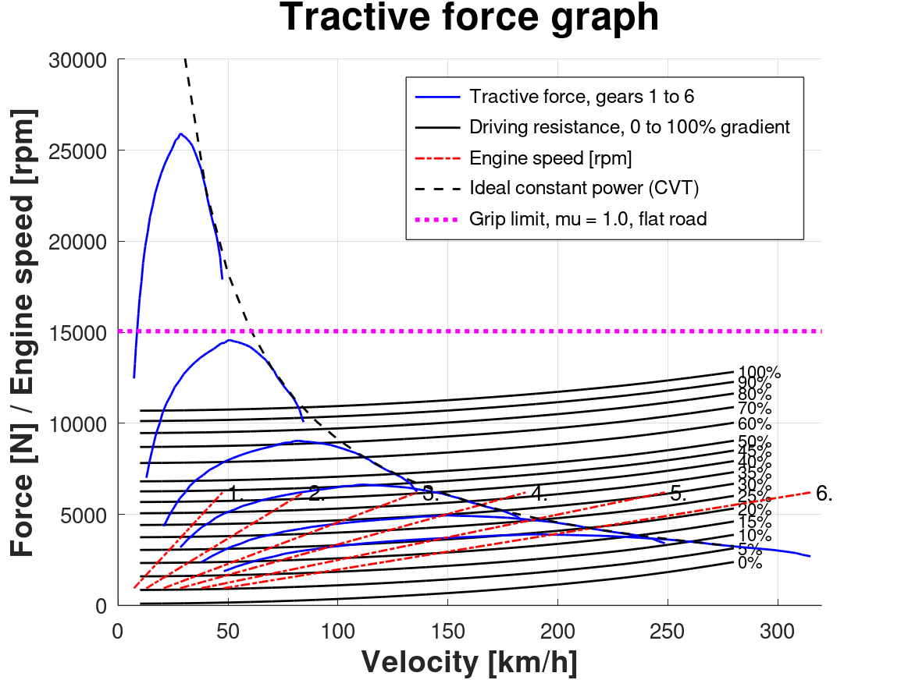
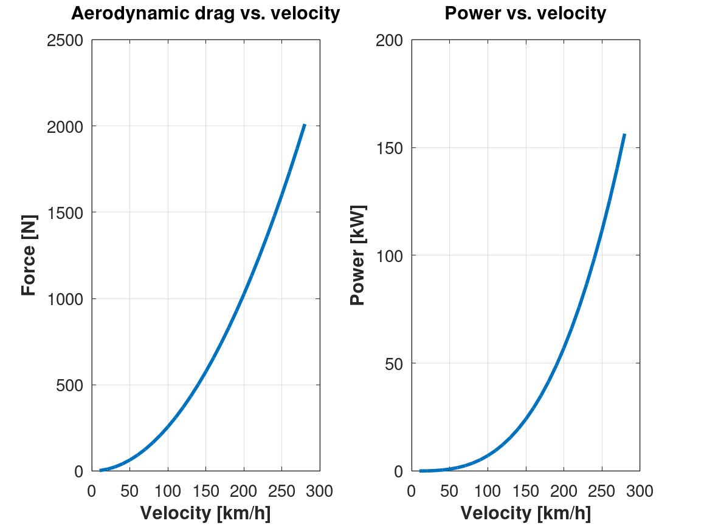
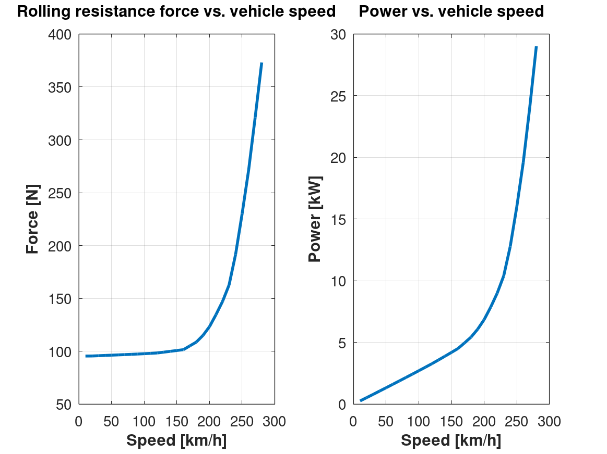
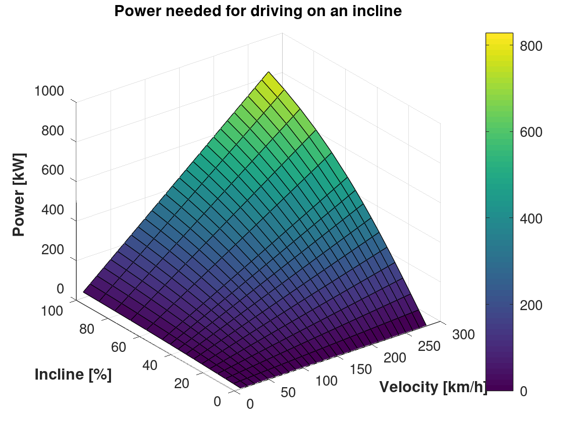
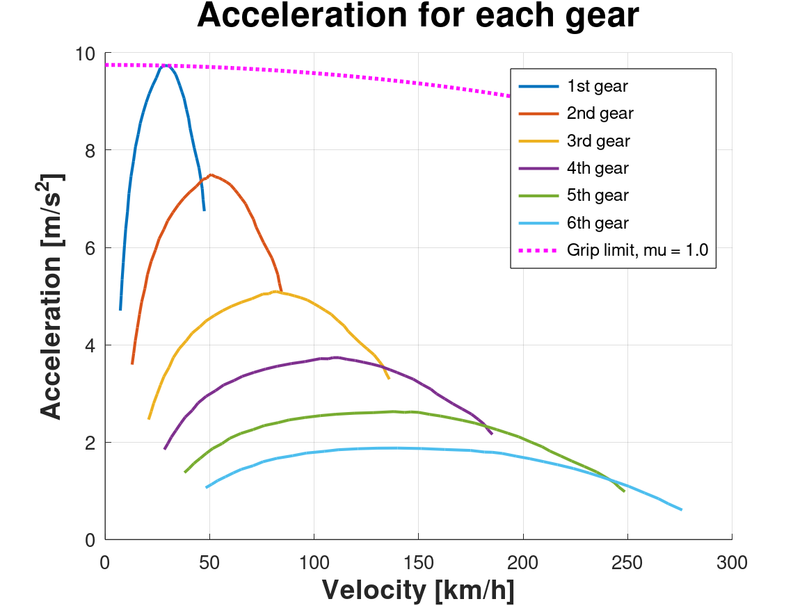
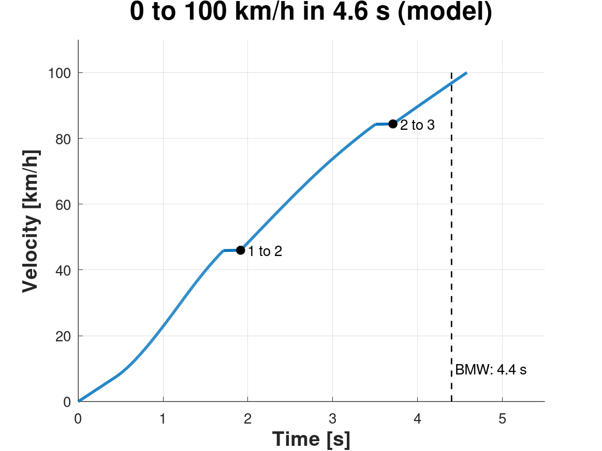

# BMW i8 Vehicle Performance Analysis (GNU Octave / MATLAB)

Longitudinal vehicle dynamics of the BMW i8 Coupé: driving resistances, tractive force and acceleration in each of the six gears, climbing ability, top speed, and a 0–100 km/h run checked against BMW's published time.



---

## Results

| Result | Model | BMW |
|--------|-------|-----|
| 0–100 km/h | 4.6 s with two gear changes of 0.2 s, 4.2 s with instant gear changes | 4.4 s |
| Gear changes | 1 to 2 at 46 km/h, 2 to 3 at 84 km/h | |
| Highest acceleration | 9.7 m/s² in 1st gear, at the grip limit | |
| Top speed | Above 280 km/h, the end of the tyre data (6th gear still accelerates at 0.53 m/s² there) | 250 km/h, electronically limited |
| Steepest gradient, steady speed | 1st 99.5%, 2nd 99% (both limited by grip), 3rd 72%, 4th 45%, 5th 29.5%, 6th 20.5% | |

BMW's 4.4 s lies between the model's time with and without the shift time, so the inputs and the force model are consistent with the real car.

---

## Vehicle data

All inputs are in [`scripts/VehicleData.m`](scripts/VehicleData.m), each with its source.

| Parameter | Value | Source |
|-----------|-------|--------|
| Mass | 1,535 kg (unladen, DIN) | BMW 2018 |
| Axle load, front / rear | 49% / 51% | BMW 2018 |
| Wheelbase | 2.800 m | BMW 2018 |
| Centre of gravity height | 0.465 m (0.36 × height of 1.293 m) | Estimate |
| System power | 275 kW | BMW 2018 |
| System torque curve | Peak 571.5 Nm at about 3,700 rpm, engine and electric motor together | Model input |
| Gear ratios | 4.459, 2.508, 1.556, 1.142, 0.851, 0.672 | BMW 2017 |
| Final drive | 3.681 | BMW 2017 |
| Drivetrain efficiency | 0.92 | Assumed |
| Drag coefficient, frontal area | 0.26, 2.15 m² | BMW 2018 |
| Tyres | 215/45 R20 front (load index 95), 245/40 R20 rear (load index 103) | BMW 2017 |
| Dynamic rolling radius | 0.333 m | Estimate |
| Rolling resistance coefficient | 0.0092 at 10 km/h, rising to 0.036 at 280 km/h | Assumed curve |
| Air density | 1.19 kg/m³ (100 kPa, 20 °C) | Ideal gas law |
| Tyre-road friction coefficient | 1.0, dry asphalt | Assumed |
| Time per gear change | 0.2 s | Assumed |

---

## Methods

- **Aerodynamic drag:** `Fd = ½ · ρ · cd · A · v²`
- **Rolling resistance:** speed-dependent coefficient corrected for tyre pressure and tyre load, `fR · (1.3 − 0.3·p/pT) · (1.3 − 0.3·N/G)`, calculated per axle from the axle loads. On a gradient the axle loads include the load transfer from the centre of gravity height.
- **Grade resistance:** `Fg = G · sin α` with `α = atan(gradient / 100)`, for gradients of 0 to 100%, shown as a 3D surface of power against gradient and speed.
- **Tractive force:** `Fx = η · Mm · i_f · i_g / Rd` at the speed `v = 2π · Rd · n / (60 · i_f · i_g)`, with the ideal constant-power (CVT) curve `Pmax · η / v` as an upper bound.
- **Grip limit:** both axles are driven, so the tyres can transmit at most `μ · G` on a flat road and `μ · G · cos α` on a gradient.
- **Acceleration:** `a = (Fx − FR) / (φ · m)` with the rotating mass factor `φ = 1.04 + 0.0025 · (i_g · i_f)²`, capped at the grip limit `(μ · G − FR) / m`. The mass factor is left out of the grip limit because the rotating engine and gearbox parts sit before the tyres.
- **Steepest gradient:** for each gear, the steepest gradient where the force at the wheels, the smaller of `Fx` and `μ · G · cos α`, still covers drag, rolling and grade resistance at some speed.
- **Top speed:** the speed where the acceleration in the best gear falls to zero, searched only inside the tyre data (up to 280 km/h).
- **0–100 km/h:** at every speed the car uses the gear with the most acceleration. Time is `∫ dv / a`, plus 0.2 s with no acceleration for each gear change. Below 7 km/h, the speed of 1st gear at the lowest engine speed in the data, the torque converter slips and the acceleration at 7 km/h is used.

---

## Model limits

- **Combined powertrain.** In the car, the six-speed gearbox carries only the 1.5-litre engine (170 kW, 320 Nm) to the rear wheels. The electric motor (105 kW, 250 Nm) drives the front wheels through its own two-speed gearbox. The model puts the combined system torque through the six-speed as one drivetrain, which treats the car as all-wheel drive with an ideal torque split.
- The torque curve and the rolling resistance curve are model inputs, not measurements.
- No tyre slip, launch control or electronic limits (the 250 km/h limiter, power reduction).
- Below 7 km/h the launch is simplified.
- Above 280 km/h there is no tyre data, so nothing is calculated there.
- Climbing is at a steady speed only.

---

## Figures

| Figure | Description |
|--------|-------------|
| 1 | Aerodynamic drag force and power against speed |
| 2 | Rolling resistance force and power against speed |
| 3 | Power needed on a gradient, 3D surface of gradient and speed |
| 4 | Tractive force in each gear against total resistance on 0 to 100% gradients, with engine speed, the CVT curve and the grip limit |
| 5 | Acceleration in each gear on a flat road, with the grip limit |
| 6 | 0–100 km/h, speed against time with the gear changes |

### Figure 1: Aerodynamic drag


### Figure 2: Rolling resistance


### Figure 3: Grade resistance


### Figure 4: Tractive force


### Figure 5: Acceleration


### Figure 6: 0 to 100 km/h


---

## How to run

1. Install [GNU Octave](https://octave.org/) or use MATLAB.
2. From the repository folder, run:

```octave
run('scripts/bmw_i8_analysis.m')
```

3. Six figure windows open and the results are printed in the console. The figures are also saved as PNG files in `figures/`. Set `save_figures = false` at the top of the script to skip that.

---

## Files

| File | What it is |
|------|------------|
| `scripts/bmw_i8_analysis.m` | The analysis, figures and printed results |
| `scripts/VehicleData.m` | All vehicle data, with a source for each value |
| `figures/` | The six figures as produced by the script |
| `LICENSE` | MIT licence |

---

## Sources

- BMW 2018: [BMW i8 Coupé technical data](https://press.bmwgroup.com/global/article/attachment/T0279413EN/404750), BMW Group media information, April 2018.
- BMW 2017: [2017 BMW i8 technical data](https://www.press.bmwgroup.com/usa/article/attachment/T0145577EN_US/387839), BMW Group US media information.

---

## Changes

- **October 2026:** added `VehicleData.m` to the repository with a source for every value and updated mass, axle loads, frontal area, gear ratios and final drive to BMW's published figures. Added the grip limit, the steepest gradient per gear, the top speed check and the 0–100 km/h run. Resistance is no longer extrapolated past the tyre data. Figures are now saved by the script.
- **January 2026:** first version.

[MIT license](LICENSE).
